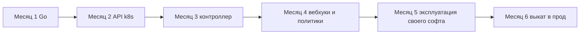

# 6 месяцев: Kubernetes SRE-разработчик

22 сентября 2026 → 22 марта 2027.

**Кем становишься:** инженер, который пишет и сопровождает автоматику кластера — контроллеры, вебхуки, политики. Не «ещё лучше крутит kubectl».

Фундамент не повторяем: Linux, сеть, kubectl, CI/CD, ArgoCD, сканеры, разбор пода, Python, нагрузка приложения.



Ритм: **8–10 часов в неделю** (два вечера по 2 часа + полдня в выходной). Неделю не доделал — следующую не начинай.

Один репозиторий на полгода, например `sre-lab`. Папки `week-01` … `week-24`. В корне `NOTES.md`: что сделал, где застрял.

Окружение: kind или k3d на ноутбуке. Staging на работе — с месяца 3, когда появится образ. Go **1.23+**.

Установка один раз в начале:

```bash
go version   # 1.23 или новее
kind create cluster --name sre-lab
# или: k3d cluster create sre-lab
kubectl cluster-info
```

---

## Месяц 1. Go

Клиент Kubernetes, контроллеры и webhook пишут на Go. Цель месяца — маленькие программы с тестами, `context` и образом в кластере. Python не замена.

### Неделя 1. Язык и тесты

**Разобрать** (по Tour of Go, не всё сразу): пакеты и `go mod`; указатели; `error`, `fmt.Errorf("%w")`, `errors.Is`; интерфейсы; слайсы и мапы; `defer`.

**Делать:**

1. Поставь toolchain, если ещё нет: https://go.dev/doc/install. Проверь `go version`.
2. Создай модуль:
   ```bash
   mkdir -p week-01 && cd week-01
   go mod init sre-lab/week01
   ```
3. Файл `parse.go`. Функция:
   ```go
   func ParseRestart(s string) (int, error)
   ```
   Вход — строка вроде `Restart Count: 3`. Нужно вытащить число. Пустая строка, мусор, отрицательное — это `error`, не `0` «как получилось».
4. Файл `parse_test.go`. Таблица:
   - `"Restart Count: 3"` → `3`, без ошибки;
   - `""` → ошибка;
   - `"abc"` → ошибка;
   - `"Restart Count: -1"` → ошибка.
   Цикл `for _, tc := range tests { t.Run(tc.name, ...) }`.
5. Запуск:
   ```bash
   go test ./...
   go test -cover ./...
   ```
   Ветка с ошибкой должна быть покрыта (не 0%).
6. В Tour of Go пройди разделы до Methods и Interfaces включительно. Effective Go — только Errors и Defer. Concurrency не читай на этой неделе.

**Читать:** [A Tour of Go](https://go.dev/tour/), [Effective Go](https://go.dev/doc/effective_go) (Errors, Defer).

---

### Неделя 2. context, HTTP, JSON

**Разобрать:** зачем в каждый исходящий запрос кладут `context.Context` (отмена, дедлайн, не «магический таймаут внутри http.Client только»). Пакеты `net/http`, `encoding/json`. Разница `http.Server` и `httptest.Server`.

**Делать:**

1. Модуль `week-02`.
2. Хендлер `GET /healthz` — тело `ok`, статус 200.
3. Хендлер `GET /echo?name=`:
   - имя есть → `Content-Type: application/json`, тело `{"name":"..."}`;
   - имени нет или пустое → 400, JSON с полем `error`.
4. Логи через `log/slog` (info на успешный echo, error на 400). В хендлерах не использовать `fmt.Println`.
5. Тесты в `handlers_test.go`:
   - поднять сервер через `httptest.NewServer` или `req := httptest.NewRequest` + `httptest.NewRecorder`;
   - проверить код, заголовок и JSON у `/echo`;
   - второй тест: хендлер, который `time.Sleep(50*time.Millisecond)`, клиент с `context.WithTimeout(parent, time.Millisecond)` — должна прийти ошибка дедлайна, не 200.
6. `go test ./...` — зелёный без ручного curl как единственной проверки. Curl можно для себя, но тест обязателен.

**Читать:** [Go blog: Context](https://go.dev/blog/context), [`net/http`](https://pkg.go.dev/net/http).

---

### Неделя 3. Конкурентность

**Разобрать:** горутина; канал; либо `golang.org/x/sync/errgroup`, либо `sync.WaitGroup` + канал ошибок — **выбери одно** и не мешай. Что такое data race. Зачем `go test -race`.

**Делать:**

1. Модуль `week-03`. Функция:
   ```go
   func FetchAll(ctx context.Context, urls []string) []Result
   ```
   `Result` — URL, статус (или 0), ошибка. Паники быть не должно: ошибка пишется в `Result`.
2. Все URL запрашиваются параллельно. Общий `ctx` отменяет все запросы, когда истекает дедлайн.
3. Тест: `httptest.NewServer` с двумя хендлерами (200 и 500) плюс один заведомо мёртвый порт. Проверь, что в срезе три результата и нет паники.
4. Тест на дедлайн: сервер спит 2 секунды, `ctx` на 50ms — функция возвращается быстро, в результате ошибка контекста.
5. Запуск:
   ```bash
   go test -race ./...
   ```
   Если race есть — чини (обычно запись в слайс без индекса/мьютекса). Пиши в слайс по индексу `results[i] = ...` из горутины i, так проще без мьютекса.
6. В `NOTES.md` одна команда, которой будешь гонять race и дальше: `go test -race ./...`.

**Читать:** [Race Detector](https://go.dev/blog/race-detector), [Pipelines](https://go.dev/blog/pipelines) — только идея pipeline, не все паттерны.

---

### Неделя 4. Сервис в кластер

**Разобрать:** многостейдж Dockerfile; пользователь не root; endpoint `/metrics` формата Prometheus; probe Kubernetes бьёт в `/healthz`, не в бизнес-ручку.

**Делать:**

1. Собери бинарь `health-proxy` из идей недель 2–3:
   - флаги или env: список URL через запятую, адрес listen (дефолт `:8080`);
   - фон: раз в N секунд дергает URL с общим timeout;
   - `GET /healthz` — процесс жив;
   - `GET /metrics` — Gauge/GaugeVec `targets_up{url="..."}` 0 или 1.
   Бери клиент: `github.com/prometheus/client_golang`.
2. Тест: fake HTTP-сервер «вверх», второй «лежит» — в `/metrics` одна единица, один ноль.
3. `Dockerfile`:
   ```dockerfile
   FROM golang:1.23 AS build
   WORKDIR /src
   COPY go.mod go.sum ./
   RUN go mod download
   COPY . .
   RUN CGO_ENABLED=0 GOOS=linux go build -o /health-proxy .
   FROM gcr.io/distroless/static:nonroot
   COPY --from=build /health-proxy /health-proxy
   USER nonroot:nonroot
   ENTRYPOINT ["/health-proxy"]
   ```
   Если distroless неудобен — `scratch` + скопировать CA; не `FROM ubuntu` «на всякий».
4. Сборка и kind:
   ```bash
   docker build -t health-proxy:week04 .
   kind load docker-image health-proxy:week04 --name sre-lab
   ```
5. Манифест Deployment+Service:
   - `image: health-proxy:week04`, `imagePullPolicy: IfNotPresent`;
   - `securityContext.runAsNonRoot: true`;
   - `livenessProbe` и `readinessProbe` на `/healthz`;
   - `resources.requests/limits` хотя бы символические.
6. Проверка:
   ```bash
   kubectl apply -f deploy.yaml
   kubectl rollout status deploy/health-proxy
   kubectl port-forward svc/health-proxy 8080:8080
   curl -s localhost:8080/metrics | grep targets_up
   ```
7. ArgoCD Application на staging — только если образ уже в вашем registry и это не съест всю неделю. Иначе оставь на неделю 12.

**Читать:** [Prometheus Go client](https://pkg.go.dev/github.com/prometheus/client_golang/prometheus), [Distroless](https://github.com/GoogleContainerTools/distroless).

Месяц 1 можно считать пройденным, когда HTTP-сервис с тестами, `context`, `-race` и подом в kind работает.

---

## Месяц 2. API Kubernetes глазами программы

Контроллер — цикл: прочитал объекты → посчитал желаемое → записал. Без понимания API будешь копировать туториалы.

### Неделя 5. Объекты

**Разобрать:** Kind `Pod` vs resource `pods`; `apiVersion`; объект в namespace vs cluster-scoped (`Node`, `Namespace`); поля `metadata.uid`, `resourceVersion`, `generation`, `ownerReferences`; почему `status` нельзя заносить в тот же патч, что `spec`, без понимания subresource.

**Делать:**

1. Возьми любой под в kind:
   ```bash
   kubectl get pod -A | head
   kubectl get pod <ns>/<name> -o yaml > week-05/pod.yaml
   ```
   В комментариях (отдельный `pod.annotated.yaml` или заметка) распиши: uid, resourceVersion, generation, ownerReferences, что в spec, что в status.
2. ConfigMap и смена версии:
   ```bash
   kubectl -n default create configmap week05 --from-literal=k=v
   kubectl -n default get cm week05 -o jsonpath='{.metadata.resourceVersion}{"\n"}'
   kubectl -n default annotate cm week05 demo=1 --overwrite
   kubectl -n default get cm week05 -o jsonpath='{.metadata.resourceVersion}{"\n"}'
   ```
   Число должно вырасти. В `NOTES.md` своими словами: почему это значение нельзя захардкодить в программе.
3. Модуль `week-05`. Зависимость:
   ```bash
   go get k8s.io/client-go@latest
   go get k8s.io/apimachinery@latest
   ```
   Программа: kubeconfig из `~/.kube/config` (как `kubectl`). Флаг `-namespace` (дефолт `default`). Печать: имя пода, namespace, фаза. `clientset.CoreV1().Pods(ns).List`.
4. Если список пустой — создай nginx на одну реплику и повтори.
5. Обработка ошибок: нет файла kubeconfig, нет прав, неверный namespace — `log.Fatal` с текстом ошибки, не panic по nil client.

**Читать:** [API conventions](https://github.com/kubernetes/community/blob/master/contributors/devel/sig-architecture/api-conventions.md) — Types, names, Metadata. Не весь репозиторий community.

---

### Неделя 6. Informer и очередь

**Разобрать:** чем `watch` лучше `for { list; sleep 2 }` (нагрузка на API, пропуск событий). Informer = первый list, потом watch, локальный кэш. Workqueue: ключ `namespace/name`, повтор с backoff если обработчик вернул ошибку. Обработка at-least-once: один ключ может прийти дважды.

**Делать:**

1. Скопируй структуру из [sample-controller](https://github.com/kubernetes/sample-controller): factory informers, не обязательно весь репозиторий.
2. SharedInformer на `ConfigMap` в одном namespace (флаг). Обработчики Add/Update/Delete кладут ключ в `workqueue.NewRateLimitingQueue`.
3. Worker: достаёт ключ, печатает событие. Каждый третий ключ возвращает `fmt.Errorf("injected")` — очередь должна отдать его снова (увидишь повтор в логе).
4. `factory.Start(stopCh)` + `WaitForCacheSync`. Без sync не обрабатывай — иначе пустой кэш.
5. Остановка: `signal.Notify` на SIGINT/SIGTERM → закрыть `stopCh` → `queue.ShutDown()`. Проверка: `Ctrl+C` без зависания.
6. Демо руками:
   ```bash
   go run . -namespace default
   kubectl -n default create cm watch-me --from-literal=a=1
   kubectl -n default annotate cm watch-me x=y --overwrite
   kubectl -n default delete cm watch-me
   ```
   В логе три типа событий, без бесконечного List каждую секунду (это видно по отсутствию спама GET в `kubectl proxy` логах, если включишь verbose у клиента).

**Читать:** README sample-controller, [`workqueue`](https://pkg.go.dev/k8s.io/client-go/util/workqueue).

---

### Неделя 7. RBAC для робота

**Разобрать:** ServiceAccount — идентичность пода. Role — права в одном namespace. ClusterRole — на кластер. RoleBinding связывает SA и Role. Verb (`get`, `list`, `watch`, `update`) + resource (`configmaps`). В проде контроллер не должен ходить с твоим пользовательским kubeconfig.

**Делать:**

1. Манифесты:
   ```yaml
   # ServiceAccount cm-watcher в namespace sre-lab (создай ns)
   # Role: apiGroups: [""], resources: [configmaps], verbs: [get, list, watch]
   # RoleBinding: sa cm-watcher -> этот Role
   ```
2. Проверка от имени SA:
   ```bash
   kubectl auth can-i list configmaps -n sre-lab --as=system:serviceaccount:sre-lab:cm-watcher
   kubectl auth can-i list pods -n sre-lab --as=system:serviceaccount:sre-lab:cm-watcher
   ```
   Первое yes, второе no.
3. Запусти программу недели 6 **в кластере** под этим SA (маленький Deployment, образ с твоим вотчером, `serviceAccountName: cm-watcher`). Либо с машины: токен SA (для учёбы) — но цель именно in-cluster config:
   ```go
   rest.InClusterConfig()
   ```
4. В коде вотчера добавь `List` подов (намеренно). В логе должен быть `Forbidden`, процесс не падает. Текст ошибки сохрани в `NOTES.md`.
5. Role на `update deployments` **не создавай** на этой неделе.

**Читать:** [RBAC](https://kubernetes.io/docs/reference/access-authn-authz/rbac/).

---

### Неделя 8. Первый reconcile руками

**Разобрать:** reconcile — «сделай так, чтобы реальность совпала со spec». Повторный прогон без изменения spec не должен дёргать API зря (идемпотентность). Пока своего CR нет — желаемое лежит в ConfigMap, факт — в Deployment.

**Делать:**

1. Namespace `sre-lab`. Deployment `demo` (nginx), `replicas: 1`. ConfigMap `desired-replicas` с ключом `n=1`.
2. Программа:
   - watch/get ConfigMap `desired-replicas`;
   - читает `n`;
   - `Get` Deployment `demo`;
   - если `*deploy.Spec.Replicas != n` — Update/Patch **только** `spec.replicas`;
   - нет ConfigMap — лог warning, повтор через 30 секунд, не panic;
   - нет Deployment — ошибка в логе, requeue.
3. RBAC: к правам недели 7 добавь `get`, `list`, `watch`, `update` на `deployments` в `apps`, только `sre-lab`.
4. Метрика Prometheus `reconcile_total{result="ok|error"}` — инкремент в конце цикла.
5. Проверка:
   ```bash
   kubectl -n sre-lab create cm desired-replicas --from-literal=n=1 --dry-run=client -o yaml | kubectl apply -f -
   kubectl -n sre-lab patch cm desired-replicas --type merge -p '{"data":{"n":"3"}}'
   kubectl -n sre-lab get deploy demo -o jsonpath='{.spec.replicas}{"\n"}'   # 3
   ```
   Дважды подряд apply того же `n=3`: в YAML Deployment меняется только `resourceVersion`/`generation` по необходимости, ты не затираешь image, env, probes.
6. Не реализуй управление всем Deployment — только replicas.

Месяц 2 пройден, когда есть цикл «конфиг в кластере → программа меняет объект» и SA без cluster-admin.

---

## Месяц 3. Контроллер на Kubebuilder

В проде informer руками не собирают. Берут controller-runtime: менеджер, кэш, свои типы, статус.

### Неделя 9. Каркас и CRD

**Разобрать:** CRD — новый вид объекта в API. Группа (типа `sre.lab.example`), версия `v1`, Kind. В Go: структура `Spec` и `Status` с json-тегами. Маркеры `// +kubebuilder:...` генерируют CRD YAML.

**Делать:**

1. Установи kubebuilder по [книге](https://book.kubebuilder.io/quick-start.html).
2. Проект (один раз, дальше недели идут в нём, не в `week-09` с нуля):
   ```bash
   mkdir replica-tune && cd replica-tune
   kubebuilder init --domain lab.example --repo sre-lab/replica-tune
   kubebuilder create api --group sre --version v1 --kind ReplicaTune
   ```
   Да, controller + resource.
3. Поля Spec: `TargetName` (string, имя Deployment), `Min int32`, `Max int32`. Status: `ObservedReplicas`, `LastError`. Прогони `make generate manifests`.
4. Kind:
   ```bash
   make install
   kubectl get crd replicatunes.sre.lab.example
   ```
5. Пример CR `config/samples/`:
   ```yaml
   spec:
     targetName: lab-nginx
     min: 1
     max: 3
   ```
   `kubectl apply -f config/samples/...` затем `kubectl get replicatune -o yaml` — твои поля на месте. Reconcile пока может быть пустым.
6. `make test` из шаблона — зелёный.

**Читать:** Kubebuilder book: Quick Start и CronJob tutorial главы 1–3.

---

### Неделя 10. Reconcile

**Разобрать:** `ctrl.Result{RequeueAfter: ...}` vs возврат `error` (backoff). `Patch` vs `Update` (конфликт `resourceVersion` — перечитать и повторить). Conditions в status (`Type`, `Status`, `Reason`). Ошибку нельзя глотать пустым `return nil, nil`, если мир не сошёлся.

**Делать:**

1. Логика (только namespace, где крутится лаба, и только Deployment с префиксом `lab-`, чтобы не задеть чужое):
   - Get ReplicaTune;
   - Get Deployment `spec.targetName`;
   - нет Deployment → `status.lastError`, condition Degraded, `RequeueAfter: 30s`, без panic;
   - `replicas < min` → patch replicas=`min`;
   - `replicas > max` → patch replicas=`max`;
   - иначе ничего не патчить;
   - записать `observedReplicas`.
2. Клиент: `r.Update` на spec Deployment; status CR — `r.Status().Update`. После конфликта — вернуть error, runtime повторит.
3. Лог одной строкой: `reconcile ReplicaTune/foo deployment/lab-nginx 5 -> 3`.
4. Тесты (`envtest` уже в шаблоне kubebuilder):
   - replicas 0, min 2 → стало 2;
   - replicas 10, max 3 → стало 3;
   - replicas 2, min 1 max 5 → без изменения;
   - нет Deployment → нет panic, в status ошибка.
5. `make test`. Руками:
   ```bash
   make run    # контроллер локально, kubeconfig на kind
   kubectl apply -f config/samples/
   kubectl scale deploy/lab-nginx --replicas=10
   # контроллер должен вернуть в max
   ```

**Читать:** FAQ [controller-runtime](https://github.com/kubernetes-sigs/controller-runtime) про cache и Get после Update.

---

### Неделя 11. Owner и фильтры

**Разобрать:** `Owns(&appsv1.Deployment{})` — изменения Deployment тоже будят reconcile владельца. `OwnerReference` — garbage collection удаляет потомка вместе с CR. Предикат `GenerationChangedPredicate` — не реагировать на status-only апдейты.

**Делать:**

1. Для **учебного** Deployment `lab-*`, который ты сам создал под эксперимент, ставь OwnerReference на ReplicaTune. На прод-деплои компании owner **не ставить**.
2. В `SetupWithManager`:
   ```go
   For(&srev1.ReplicaTune{}).
   Owns(&appsv1.Deployment{}).
   WithEventFilter(predicate.GenerationChangedPredicate{})
   ```
   (фильтр подправь, если начнёт пропускать нужные события — зафиксируй в NOTES).
3. Проверка GC:
   ```bash
   kubectl delete replicatune <name>
   kubectl get deploy lab-nginx   # если owner стоял — объекта нет
   ```
4. В коде комментарий 5–7 строк: почему OwnerReference на чужой Deployment в проде опасен (удалили CR — снесли приложение).

---

### Неделя 12. Образ, RBAC, GitOps

**Разобрать:** namespace `sre-lab`; kustomize `config/default`; тег образа не `latest`; автосинк ArgoCD на первом выкате выключен, чтобы не зациклить поломку.

**Делать:**

1. В CI репозитория (GitLab/GitHub Actions — что есть):
   - `go test ./...`;
   - `docker build` / buildah, тег `$CI_COMMIT_SHA`;
   - push в ваш registry.
2. `make docker-build docker-push IMG=registry.example/sre-lab/replica-tune:$SHA`.
3. `config/manager` — image, resources, `securityContext`. Правки RBAC в `config/rbac`: только `replicatunes`, `deployments` в нужном namespace. Не cluster-admin.
4. Kind: загрузить образ или pull из registry, `make deploy IMG=...`.
5. Staging: тот же манифест. Application в ArgoCD:
   - `syncPolicy.automated` выключен;
   - dest namespace `sre-lab`;
   - руками Sync один раз.
6. Requests/limits у менеджера заданы. Скрейп метрик: аннотация/ServiceMonitor как у вас принято, метрика `controller_runtime_reconcile_total`. `kubectl port-forward` на 8080 менеджера и `curl /metrics | grep reconcile`.

Месяц 3 пройден, когда CR в staging меняет учебный Deployment, тесты зелёные, процесс крутится под SA, не с твоего ноутбука под admin.

---

## Месяц 4. Вебхуки и политики

Контроллер чинит мир после факта. Admission webhook решает **до** записи в etcd. Кривой webhook с `failurePolicy: Fail` останавливает apply во всём кластере.

### Неделя 13. Validating webhook

**Разобрать:** цепочка admission. `failurePolicy: Fail` — API отвергает объект, если webhook недоступен. `Ignore` — пропускает. `timeoutSeconds` (часто 10). Вебхук — отдельный HTTPS endpoint, сертификат должен совпасть с тем, что в `ValidatingWebhookConfiguration`.

**Делать:**

1. `kubebuilder create webhook --group sre --version v1 --kind ReplicaTune --programmatic-validation`.
2. В `ValidateCreate/Update`: если `min > max` — вернуть ошибку API (`field.Invalid`).
3. Сертификаты: cert-manager **или** генерация kubebuilder (`make uninstall/install` по книге, раздел webhooks). На kind проще cert-manager:
   ```bash
   kubectl apply -f https://github.com/cert-manager/cert-manager/releases/latest/download/cert-manager.yaml
   kubectl -n cert-manager rollout status deploy/cert-manager
   ```
4. Проверка:
   ```bash
   kubectl apply -f bad.yaml    # min: 5, max: 1  → отказ, объект не создался
   kubectl apply -f good.yaml   # ok
   ```
5. На **kind** сломай вебхук: `kubectl -n sre-lab scale deploy replica-tune-controller-manager --replicas=0` (имя по факту). Сравни:
   - в CRD/webhook config `failurePolicy: Fail` — apply ReplicaTune не проходит;
   - смени на `Ignore`, apply проходит.
   Запиши в NOTES оба поведения. Потом верни replicas=1 и Fail, если так решишь для лабы.

**Читать:** [Admission webhooks](https://kubernetes.io/docs/reference/access-authn-authz/extensible-admission-controllers/).

---

### Неделя 14. Mutating webhook

**Разобрать:** mutating возвращает JSON patch. Порядок: сначала mutating, потом validating. Мутация должна быть идемпотентной: второй apply не добавляет лейбл десять раз и не меняет уже правильное значение.

**Делать:**

1. Webhook на `apps/v1` Deployment, namespace `sre-lab` (objectSelector/namespaceSelector — не весь кластер).
2. Нет лейбла `cost-center` → добавить `cost-center=unknown`. Есть — не трогать.
3. `kube-system` и `kube-public` не в selector.
4. Тест (envtest или ручной):
   ```bash
   kubectl -n sre-lab create deploy mut-me --image=nginx --dry-run=client -o yaml \
     | kubectl apply -f -
   kubectl -n sre-lab get deploy mut-me -o jsonpath='{.metadata.labels.cost-center}{"\n"}'
   ```
   Повторный apply — лейбл тот же, не `unknown,unknown`.
5. Validating с недели 13 должен по-прежнему отсекать `min > max`.

---

### Неделя 15. Kyverno или Gatekeeper

**Разобрать:** движок политик — декларативные правила без своего Go. Режим `audit` (нарушения видны, apply проходит) vs `enforce` (apply блокируется). kube-system всегда в исключениях.

**Делать:**

1. Поставь **одно**. На kind проще Kyverno. Gatekeeper — если на работе уже он, не ставь второй.
2. Три политики, сначала `validationFailureAction: Audit` (в Kyverno) / `enforcementAction: dryrun` (Gatekeeper):
   - образ не тег `latest` и не без тега;
   - в namespace `sre-lab` нельзя `runAsRoot` / `runAsNonRoot: false`;
   - у контейнера есть `resources.requests.cpu` и `memory`.
3. Подожди день-два (или прогони `kubectl get` отчёт Kyverno PolicyReport). Посчитай, сколько нарушений в `sre-lab`.
4. Для `sre-lab` переведи те же три правила в enforce. Остальной кластер не трогай.
5. Это не про CVE и не второй Trivy.

**Читать:** раздел writing policies выбранного движка, три официальных примера, не весь каталог.

---

### Неделя 16. Секреты и права контроллера

**Разобрать:** kubeconfig в образе = ключ от кластера в registry. У пода есть ServiceAccount token (bound token, короткая жизнь). `automountServiceAccountToken: false` если токен не нужен. Vault / External Secrets / Sealed Secrets — только то, что **уже есть** в компании.

**Делать:**

1. Grep по репозиторию: нет `certificate-authority-data` пользовательского админа в манифестах, нет `config` kubeconfig в Dockerfile `COPY`.
2. Контроллер только `InClusterConfig`.
3. Сужение RBAC: выпиши verbs по одному. Проверка:
   ```bash
   kubectl auth can-i --list --as=system:serviceaccount:sre-lab:controller-manager -n sre-lab
   ```
   Лишние `*` и `secrets` на запись убери, если не нужны.
4. Секрет для лабы: если есть ESO/Vault — один Secret в namespace контроллера оттуда. Если нет — не ставь Vault. Sealed-secrets или штатный Secret, созданный пайплайном.
5. Ротация: удали под контроллера, он должен подняться с новым токеном SA без ручного секрета.

Месяц 4 пройден, когда плохой CR не создаётся, политики в git, контроллер без admin и без kubeconfig в git.

---

## Месяц 5. Эксплуатация своего софта

Написанный контроллер без сигналов и плана выката — пет-проект. Дальше — как с любым продовым сервисом, только радиус поражения больше (admission).

### Неделя 17. Метрики и алерты

**Разобрать:** из коробки controller-runtime отдаёт `controller_runtime_reconcile_total`, `controller_runtime_reconcile_time_seconds`, глубину workqueue. SLO не CPU: очередь не растёт неограниченно; p99 reconcile меньше выбранного порога; latency webhook меньше `timeoutSeconds`.

**Делать:**

1. Service/ServiceMonitor (или scrape-annot) как в вашем Prometheus. Проверь `curl /metrics` из пода.
2. Grafana (или JSON dashboard в git): rate ошибок reconcile; histogram p99; `workqueue_depth`.
3. Два алерта:
   - глубина очереди > 0 (или > N) 15 минут;
   - p99 webhook / reconcile > 80% от timeout admission.
4. Нагрузка на kind:
   ```bash
   for i in $(seq 1 100); do
     kubectl apply -f - <<EOF
   apiVersion: sre.lab.example/v1
   kind: ReplicaTune
   metadata: { name: load-$i, namespace: sre-lab }
   spec: { targetName: lab-nginx, min: 1, max: 3 }
   EOF
   done
   ```
   QPS клиента контроллера не поднимай в космос. Сними скрин/числа p99 и depth. Потом удали `load-*`.
5. Если apiserver начал тормозить — уменьши параллелизм, добавь `client.QPS`/`Burst` в менеджер осознанно, запиши значения.

**Читать:** [Kubebuilder metrics](https://book.kubebuilder.io/reference/metrics).

---

### Неделя 18. Отладка reconcile

**Разобрать:** флаги zap (`--zap-log-level=debug`). `Event` на CR (`kubectl describe replicatune`). Лог должен содержать `namespace/name`, чтобы грепать один ключ.

**Делать:**

1. Сломай downstream: удали `lab-nginx`, оставь ReplicaTune. В status — понятная ошибка, в Events — Warning, метрика `result="error"` растёт. Контроллер не CrashLoop.
2. Runbook `docs/runbook.md` на 8 шагов, без «рестартни под»:
   - `kubectl get replicatune -A`;
   - `describe` + Events;
   - логи менеджера `grep <name>`;
   - `get deploy <target>`;
   - RBAC `auth can-i`;
   - метрики очереди;
   - webhook config при ошибках admission;
   - когда эскалировать.
3. pprof: включи только на staging/kind, NetworkPolicy или listen на localhost + port-forward. Сними heap после прогона 100 CR:
   ```bash
   kubectl port-forward -n sre-lab deploy/controller-manager 8082:8082
   go tool pprof -http : http://localhost:8082/debug/pprof/heap
   ```
   Порт уточни по манифесту kubebuilder (`metrics` vs `pprof`).

---

### Неделя 19. Выкат с webhook

**Разобрать:** если сначала обновить ValidatingWebhookConfiguration на новый service/path, а подов ещё нет — при Fail кластер не принимает ресурсы. Правильный порядок: новый ReplicaSet Ready (пробы зелёные), потом конфиг webhook. `timeoutSeconds`. Conversion webhook между версиями CRD — прочитай зачем, реализовывать новую версию API на этой неделе не обязательно.

**Делать:**

1. Файл `docs/upgrade.md`: два сценария — контроллер без webhook и с webhook. Нумерация шагов.
2. На kind под нагрузкой:
   ```bash
   # в одном окне
   while true; do kubectl apply -f config/samples/good.yaml; sleep 1; done
   # в другом
   kubectl -n sre-lab rollout restart deploy/controller-manager
   kubectl -n sre-lab rollout status deploy/controller-manager
   ```
   Считаешь, были ли массовые ошибки apply (connection refused, timeout, 500).
3. Если были: `replicas: 2`, PDB `minAvailable: 1`, проверить `failurePolicy`. Повтори эксперимент.
4. Допиши в upgrade.md фактический итог: «во время rolling update apply проходили / не проходили».

---

### Неделя 20. Авария своего компонента

**Разобрать:** умер только reconciler — объекты в etcd остаются, просто перестают сходиться. Умер webhook с Fail — **люди не могут apply**. Бэкап состояния = YAML CRD+CR, не только PVC.

**Делать:**

1. Сценарий A (kind): `kubectl -n sre-lab scale deploy/controller-manager --replicas=0`, подожди 10 минут, потыкай приложение `lab-nginx`. Запиши: что живёт, что замерло, нужен ли page сразу.
2. Сценарий B: webhook Fail, поды webhook=0. Покажи, что apply ReplicaTune (и возможно других ресурсов, если селектор широкий) ломается. Разблокировка:
   ```bash
   kubectl get validatingwebhookconfiguration
   kubectl delete validatingwebhookconfiguration <name>
   ```
   Это break-glass. В runbook: кто имеет право, что восстановить после. Не выдавай delete webhook всем.
3. Бэкап на staging/kind:
   ```bash
   kubectl get crd replicatunes.sre.lab.example -o yaml > backup/crd.yaml
   kubectl get replicatune -A -o yaml > backup/cr.yaml
   ```
   CronJob или job в CI раз в сутки на staging — по возможности.
4. Верни контроллер и webhook в рабочее состояние.

Месяц 5 пройден, когда на свой софт есть дашборд и алерты, runbook, план выката webhook и описанный break-glass.

---

## Месяц 6. Одна задача с работы

Без прод-задачи полгода — кружок. Одна боль, один репозиторий, узкий выкат. Не десять идей.

Примеры (бери реальную, не выдумывай):

- в namespace забывают requests → политика audit, потом enforce;
- реплики сервиса ночью крутят руками → CR «расписание»;
- Application в Argo в Unknown без алерта → маленький watcher;
- privileged запрещён кроме двух SA;
- обязателен лейбл cost-center.

### Неделя 21. Дизайн

Напиши `DESIGN.md` на 1–3 страницы, разделы:

1. Проблема: как часто, кто страдает, сколько времени жрёт.
2. Почему мало CronJob/ручного скрипта.
3. API: CR, webhook или политика Kyverno — и почему.
4. RBAC: от какого SA, какие verbs.
5. Отказ: контроллер мёртв / webhook мёртв — что с кластером и с приложениями.
6. Откат: удалить Application, удалить webhook config, оставить CRD или нет.
7. Успех через 14 дней: одно число (нарушения, тикеты, ручные scale).

Отдай одному коллеге. Впиши возражения и что с ними сделал.

---

### Неделя 22. Срез на staging

Не весь DESIGN. Вертикальный кусок: happy path.

1. Код/политики + тесты на этот срез.
2. Включение только по лейблу namespace (`sre-lab` или тестовый ns продукта).
3. RBAC как в DESIGN, без cluster-admin «пока так».
4. Выкат в staging через тот же пайплайн, что неделя 12.
5. Проверка: сценарий из DESIGN проходит; негативный сценарий (плохой объект) — ожидаемый отказ.

---

### Неделя 23. Узкий прод

1. Один namespace или один сервис, письменно согласованный.
2. Алерты недели 17 на этот инстанс.
3. Сообщение команде: что изменилось, как обойти (лейбл, аннотация), кого звать, ссылка на runbook.
4. Семь дней смотри: ложные срабатывания, QPS к apiserver (`apiserver_request_total` по verb/resource твоего SA), жалобы в чате. Правь пороги, не выключай всё сразу.

---

### Неделя 24. Ретро

1. Число из DESIGN: замерь факт. Запиши до/после.
2. Дыры: нет HA webhook, нет conversion, тесты тонкие, RBAC шире чем надо.
3. На следующий квартал: добить этот компонент или остановиться (не начинать Istio «на волне успеха»).
4. Файл `RETRO.md` со ссылками на дашборд и PR.

Месяц 6 пройден, когда в узком проде крутится твоя автоматика, на неё есть алерт и есть число до/после.

---

## Как вести NOTES.md

После каждой недели четыре строки:

```
Неделя N:
Сделал:
Проверил так:
Не закрыто:
```

«Не закрыто» третий раз подряд — выкинь побочное (красивый дашборд, второй движок политик), добей текущую неделю.
