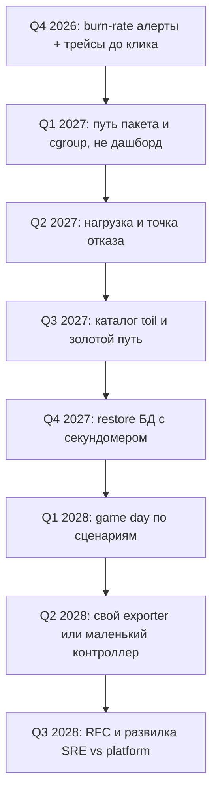

# SRE: конкретный план на 24 месяца

Сентябрь 2026 → сентябрь 2028.

Ближайшие 6 месяцев: [6-months.md](6-months.md) — 24 недели, профиль «Kubernetes SRE-разработчик» (Go → контроллер → вебхуки → выкат). Пока идёшь по нему, этот файл не параллелить.

Стартовая точка: прод уже есть. Kubernetes, Linux, Docker, CI/CD, ArgoCD, IaC, SLO, инциденты, метрики/логи/трейсы, SonarQube, Trivy, базы — это не цель, это пол. Дальше не «научиться middle», а следующий слой: **меньше ручной работы, глубже разбор отказов, система, которая падает предсказуемо**.

Каждый квартал закрывается **артефактом**, не ощущением «я это знаю». Если артефакта нет — квартал не закрыт.

Не делать параллельно: Kafka «на всякий», service mesh с нуля, третье облако, коллекция сканеров, CKA вместо работы ниже. CKA — только если конкретная вакансия режет им резюме.

---

## Как пользоваться

Одна ставка на квартал. Три вечера в неделю по 60–90 минут + то, что можно втащить в рабочие задачи.

Еженедельно, независимо от квартала:

1. Один разбор: инцидент, странный алерт или медленный запрос. Короткий текст: симптом → гипотезы → что проверил → причина → что изменил, чтобы не повторилось.
2. Один кусок официальной доки, не курс: Prometheus, Kubernetes, Grafana, Postgres — по теме квартала.
3. Любой повторяющийся запрос в Slack/тикетах сразу писать в каталог toil (см. Q3 2027). Не ждать конца года.

---

## Q4 2026 — алерты по SLO, не по CPU

**Зачем:** уметь нарисовать SLO мало. Нужно, чтобы пейджер звонил, когда тает error budget, а не когда диск на 70%.

### Сделать

1. Взять один пользовательский путь (логин, создание заказа, выкладка — что реально бесит бизнес). Записать SLI формулой, не словами:
   - доступность: `sum(rate(http_requests_total{code!~"5.."}[5m])) / sum(rate(http_requests_total[5m]))`;
   - латентность: гистограмма, не average. SLI = доля запросов быстрее порога.
2. Повесить **multi-window burn-rate** алерты (Google SRE Workbook, глава *Alerting on SLOs*):
   - fast burn: короткий плюс длинный окна, page;
   - slow burn: длинные окна, ticket.
   Готовый каркас: [robusta.dev / Google burn-rate](https://sre.google/workbook/alerting-on-slos/) — не копировать цифры вслепую, подставить свой SLO и трафик.
3. Снести или понизить до severity=info минимум 5 symptom-алертов (`CPU > 80`, `RestartCount`, `Disk > 70` без пользовательского эффекта). Перед удалением — таблица: алерт / сколько раз за 30 дней / был ли из него полезный инцидент.
4. Трейс должен открываться **из дашборда**, не отдельной вкладкой «где-то в Jaeger»:
   - OpenTelemetry на одном сервисе (auto-instrument, если язык позволяет);
   - Tempo/Jaeger/Elastic — что уже стоит;
   - exemplars: из панели `histogram_quantile` клик в trace id.
5. Десять recording rules, которые ты реально используешь в дашбордах (`*_sli_ok`, `*_sli_total`, `*_latency_bucket:rate5m`). Не «на будущее».

### Практика PromQL (3 раза в неделю, 25 минут)

Писать запросы руками, не копировать с дашборда:

- `rate` vs `increase` vs `irate` на счётчике, который дёргается редко;
- `histogram_quantile(0.99, sum by (le) (rate(..._bucket[5m])))` — сломать `by (le)` и понять, почему quantile врёт;
- `group_left` / `ignoring` — навесить info-метрику (версия, шард) на SLI;
- `absent()` и `absent_over_time()` — алерт «скрейп умер», не «значение 0»;
- предсказание диска: `predict_linear(node_filesystem_avail_bytes[6h], 24*3600)`.

### Квартал закрыт, если

- [ ] Есть два burn-rate правила в проде (или в staging, если прод не дают трогать alerting — тогда обязательно перенос в прод в следующем квартале).
- [ ] С дашборда 5xx/p99 открывается конкретный трейс.
- [ ] Число page-алертов за месяц записано «до» и «после».
- [ ] 10 recording rules в git.

**Читать:** [SRE Workbook: Alerting on SLOs](https://sre.google/workbook/alerting-on-slos/), [PromQL docs: histogram](https://prometheus.io/docs/practices/histograms/). Не YouTube-обзор «что такое SLO».

---

## Q1 2027 — путь запроса и почему процесс убили

**Зачем:** middle чинит под. Следующий слой — доказать путь пакета и отличие CPU throttle / OOM / disk / DNS.

### Сделать на работе (на следующем реальном баге, не на учебном)

Пока баг живой, пройти цепочку и **записать выводы в runbook**:

1. Клиент → DNS → LB/Ingress → Service → Endpoints → Pod IP → контейнер.
2. На каждом хопе команда и ожидаемый результат:
   - DNS: `dig +trace`, `kubectl -n kube-system get pods -l k8s-app=kube-dns`, логи CoreDNS (`SERVFAIL` vs `NXDOMAIN`);
   - L4/L7: `kubectl get ingress,svc,endpointslices`; `curl -v` с пода-debug в ту же сеть;
   - kube-proxy/IPVS: `iptables -t nat -L KUBE-SERVICES | head` или `ipvsadm -Ln` — что реально у вас;
   - CNI: с ноды `ip route`, `bridge`/`vxlan`/`cilium` — как пакет покидает под.
3. Если 502/timeout — `tcpdump -i any host <pod-ip> and port 80` на ноде **или** ephemeral container: `kubectl debug -it <pod> --image=nicolaka/netshoot --target=<container>`.
4. Если рестарты — не «OOM, ну лимит». Развести:
   - OOM: `dmesg` / `kubectl describe` Exit 137, `container_memory_working_set_bytes` vs limit;
   - throttle: `container_cpu_cfs_throttled_seconds_total` растёт, load при этом «небольшой»;
   - liveness убивает здоровый, но медленный под: сопоставить probe timeout и p99.
   Команды на ноде: `systemd-cgtop`, для cgroup v2 — `cat /sys/fs/cgroup/.../cpu.stat` и `memory.current`.

### Лаба на staging (если неделю нет инцидента — сделать искусственно)

Четыре поломки, на каждую: время до алерта, первая команда, корневая причина.

| # | Ломаешь | Должен увидеть |
| --- | --- | --- |
| 1 | readiness на `/health` с sleep 30s | под в Service есть, трафик нет; probes vs live |
| 2 | NetworkPolicy, запрещающий DNS | `i/o timeout` в приложении, не «приложение сломалось» |
| 3 | limit memory 50Mi на жадном процессе | 137, не CrashLoop из-за конфига |
| 4 | неверный `server_name` / просроченный cert на Ingress | TLS handshake, не 404 приложения |

### Квартал закрыт, если

- [ ] Один runbook «путь HTTP-запроса в нашем кластере» со скриншотами/выводами **вашего** CNI и Ingress, не из гайда.
- [ ] Таблица из 4 поломок заполнена.
- [ ] Можешь за 5 минут объяснить разницу OOM / throttle / probe-kill на цифрах своего кластера.

**Читать:** [Debug running pods](https://kubernetes.io/docs/tasks/debug/debug-application/debug-running-pod/), дока вашего CNI (Calico/Cilium/Flannel — одна, не все три).

---

## Q2 2027 — нагрузка до поломки

**Зачем:** SLO без ёмкости — гадание. Нужно число: сервис умирает на N rps, потому что X (CPU, lock в БД, очередь, saturating downstream).

### Сделать

1. Выбрать один сервис. Написать k6 (или vegeta, если проще) сценарий **реального** пути, не `GET /health`:
   - разгон 5–10 минут, не спайк на 3 секунды;
   - смотреть p50/p99, error rate, saturating метрики: CPU throttle, очередь, DB `pg_stat_activity`, connections.
2. Найти **первую** стену. Зафиксировать в одной странице:
   - N rps / concurrency, при которых ломается SLO;
   - узкое место (докажи метрикой, не «наверное БД»);
   - что будет при ×2 трафика: сколько реплик, какой CPU, какой connection pool.
3. Сверить `requests/limits` с фактом за 14 дней:
   - `container_cpu_usage` vs request;
   - working set vs limit.
   Права: урезать overcommit там, где usage стабильно < 30% request, **или** поднять там, где throttle/OOM. Не «оптимизация всех деплоев».
4. HPA не по CPU, если CPU не является стеной. Варианты: RPS, in-flight, своя метрика из SLI. В git — манифест + объяснение, почему CPU-HPA врёт на этом сервисе.
5. Если язык сервиса даёт профилировщик (pprof / py-spy / async-profiler) — один профиль **под нагрузкой**, top-3 функции в той же странице.

### Квартал закрыт, если

- [ ] Есть `capacity-<сервис>.md`: стена, метрика, что менять первым.
- [ ] Один PR с right-size **или** HPA по осмысленной метрике, в проде.
- [ ] Нагрузочный сценарий лежит в git и его можно прогнать повторно.

**Читать:** [USE method](https://www.brendangregg.com/usemethod.html) (saturation vs utilization), k6 docs по thresholds. Не «Kubernetes autoscaling overview».

---

## Q3 2027 — toil в часы и золотой путь

**Зачем:** это прямой рычаг «меньше трудозатрат». Пока toil не посчитан, его не убивают — его гордо называют «поддержкой».

### Две недели замера

Таблица (хоть в заметках): дата, прерывание, минут, можно ли без человека.

Типичные классы: шумный алерт, «добавь env», «почему Argo не sync», ручной rollback, выдача доступа, «собери образ для хотфикса», ответ на один и тот же вопрос.

Итог: топ-3 по часам за 2 недели. Дальше работаешь только с ними.

### Убить №1

Не «написать доку». Сделать так, чтобы второй раз человек не был нужен:

- шум → burn-rate / freeze / route в тикет, не в page;
- env/секреты → PR-шаблон + валидация в CI;
- доступ → группа/CR, не ручной `RoleBinding`;
- «Argo красный» → runbook из 5 команд + алерт с конкретной причиной (`ComparisonError` vs `Degraded`).

До/после: часов в неделю на этот класс.

### Золотой путь нового сервиса

Один шаблон, из которого разработчик (или ты один раз) получает:

- Dockerfile / build в уже существующем CI;
- манифесты Helm/Kustomize с probes, resources, PDB, NetworkPolicy-заготовкой;
- Application в ArgoCD;
- дашборд + 2 burn-rate алерта (из Q4 2026);
- Trivy/SonarQube как уже принято у вас, без новых сканеров.

Проверка: коллега поднимает **пустой** сервис по README шаблона без тебя в созвоне. Где застрял — дыра в шаблоне, не в людях.

### Квартал закрыт, если

- [ ] Каталог toil за 2 недели.
- [ ] Класс №1 автоматизирован, есть число часов до/после.
- [ ] Шаблон сервиса в git, кто-то кроме тебя им воспользовался.

**Читать:** [SRE Book: Eliminating Toil](https://sre.google/sre-book/eliminating-toil/). Цель — не 0% toil, а чтобы toil не рос вместе с числом сервисов.

---

## Q4 2027 — база как прод, не как «она просто есть»

**Зачем:** у SRE собеседования и ночные падения часто заканчиваются в данных. Бэкап, который ни разу не восстанавливали, не существует.

### Сделать

1. **Restore с секундомером** на копии (отдельный namespace / инстанс, не поверх прода):
   - старт: команда restore;
   - стоп: приложение читает данные, не «под Postgres Running»;
   - записать RTO факт. Сравнить с тем, что все думают.
2. Проверить RPO: сколько минут данных теряете при restore с текущего бэкапа (WAL / binlog / snapshot).
3. Дашборд, без которого restore бессмысленен:
   - свежесть бэкапа;
   - replication lag, если есть реплика;
   - connections vs `max_connections`;
   - диск: `predict_linear` из Q4 2026.
4. Учения:
   - диск заполнен (или `disk full` на staging volume);
   - пул соединений исчерпан (нагенерить коннекты, увидеть ошибку приложения, найти, кто не закрывает);
   - рестарт мастера/поды БД: что видит клиент, есть ли retry, какой downtime.
5. Если бэкап только «скрипт на crontab» — оформить как проверяемый job (CronJob/CI) с алертом «бэкап старше N часов».

### Квартал закрыт, если

- [ ] Протокол restore: команды, RTO, RPO, дата прогона.
- [ ] Алерт «бэкап протух» или «lag > X» в проде.
- [ ] Один PR: retry/timeout/pool на клиенте **или** лимит коннектов, если учение это вскрыло.

**Читать:** runbook вашей БД (Postgres `backup/recovery`, MySQL dump/binlog — что у вас). Плюс [Postgres: backup and restore](https://www.postgresql.org/docs/current/backup.html) точечно под ваш способ.

---

## Q1 2028 — ломать специально

**Зачем:** game day дешевле настоящего инцидента. Цель — дыры в алертах и runbook, не «хаос ради хаоса».

### Формат одного дня (4–6 часов, staging максимально близкий к проду)

Письменно до старта: гипотеза («если убить CoreDNS, увидим алерт за 2 минуты, трафик деградирует так-то»). После — факт.

Сценарии (прогнать не меньше четырёх):

1. `kubectl delete pod` у 50% реплик критичного деплоя. PDB должен помешать худшему — если не помешал, манифест вран.
2. Заполнить диск воркера или PVC.
3. Отозвать/просрочить сертификат Ingress (staging).
4. Сломать зависимость: NetworkPolicy или неверный Service selector к БД/кэшу.
5. Задержать исходящий трафик (toxiproxy / tc netem на тестовом поде) — как ведёт себя timeout.

На каждый сценарий три поля: **детект (мин)**, **что в runbook врало**, **тикет на фикс**. Фикс в том же спринте, иначе game day — театр.

Роли: кто incident commander, кто comms, кто чинит. Даже если вас двое — чередовать. Командир не ходит в `kubectl` первым.

### Квартал закрыт, если

- [ ] Отчёт game day: 4+ сценария, дыры, ссылки на закрытые тикеты.
- [ ] Чеклист командира инцидента на одной странице (кто объявляет, где канал, когда эскалация, когда постмортем).
- [ ] Хотя бы один пробел в алертах из Q4 2026 закрыт по результатам ломания.

Инструмент: kubectl + netshoot + toxiproxy достаточно. Litmus/Chaos Mesh — если уже есть в кластере, не ставить ради галочки.

---

## Q2 2028 — софт, который дежурит вместо тебя

**Зачем:** bash и YAML не убирают целый класс toil. Нужен маленький сервис с метриками и тестами.

### Один проект, не десять скриптов

Выбрать **одну** боль из каталога Q3:

**Вариант A — exporter.** То, чего нет в Prometheus: свежесть бэкапа, drift Argo (если нет нормальной метрики), очередь тикетов, сертификаты не из blackbox, «зависший» CronJob. `prometheus_client` (Python) или `promhttp` (Go). Скрейп, dashboard, алерт.

**Вариант B — контроллер-lite.** Watch ConfigMap/Secret/Application, делает одно действие (рестарт, тикет, Slack, annotation). Kubernetes Python client или Kubebuilder, если готов к Go. Не писать «оператор кластера». Одна ответственность.

Обязательные обвязки — иначе это снова скрипт в crontab:

- Dockerfile + манифест + ArgoCD;
- `/metrics` и `/healthz`;
- тесты на логику (хотя бы на парсинг и пороги);
- CI как у остальных сервисов;
- ресурсы и лимиты, не `latest` без tag.

### Квартал закрыт, если

- [ ] Инструмент работает в staging/prod и на него есть дашборд.
- [ ] Он снимает конкретный класс toil (часы до/после).
- [ ] Репозиторий с тестом, который падает, если сломать порог/логику.

Python достаточно. Go — только если уже пишете или выбран оператор. Не учить язык «для резюме».

---

## Q3 2028 — решение, а не новый тул

**Зачем:** после двух лет нужен не Istio, а развилка: глубже в надёжность сложных систем или в platform (self-service, меньше тебя в каждом PR). Вторая ветка обычно лучше бьёт в «меньше трудозатрат».

### Сделать

1. RFC на 1–3 страницы про **реальную** дыру:
   - progressive delivery (canary/blue-green в Argo Rollouts) для одного сервиса;
   - или мультикластер / отдельный staging, если его нет;
   - или единый golden path как внутренний продукт (шаблон + пайплайн + SLO из коробки).
   В RFC: проблема, варианты, риски, как откатить, как измерить успех.
2. Прогнать RFC через команду. Даже если откажут — это нормальный исход. Файл остаётся.
3. Ревизия этого roadmap: что из артефактов живо в проде, что было театром, что тащить ещё год.
4. Сознательный выбор на 2029:
   - **SRE вглубь:** зависимости, очереди, нагрузка, сложные инциденты, capacity нескольких сервисов;
   - **platform:** шаблоны, self-service, внутренний портал/каталог, чтобы разработчики не ходили к тебе за env.

### Квартал закрыт, если

- [ ] RFC в git/wiki, с датой и решением (принято / отложено / отклонено).
- [ ] Список артефактов 2026–2028: жив / умер / заменить.
- [ ] Написано, куда идёшь в 2029 и какой **следующий** артефакт (один).

---

## Каталог упражнений (если квартальная тема на работе не даётся)

Делать на staging, не ждать разрешения «поизучать в проде».

| Упражнение | Done when |
| --- | --- |
| С нуля объяснить p99 по histogram buckets на бумажке, затем проверить PromQL | цифры совпали с Grafana |
| `kubectl debug` + netshoot: curl соседа, DNS, tcpdump 30 секунд | pcap или вывод объясняет 502 |
| Restore БД в пустой namespace | приложение читает данные, есть минуты |
| Сломать HPA: нагрузка есть, реплики не растут | найдена причина (метрика, `--horizontal-pod-autoscaler-sync-period`, custom metric) |
| ArgoCD: искусственный drift, `OutOfSync`, sync/rollback | записан порядок команд без UI |
| Сертификат: `openssl s_client -connect` + дата expiry в метрике | алерт за 14 дней, не в день X |
| Один bpftrace/opensnoop на staging (если ядро позволяет) | поймал лишние open/connect у приложения, либо понял, почему нельзя |

---

## Что считать прогрессом

Не грейд и не вилка. Живые вещи:

| Когда | Должно существовать |
| --- | --- |
| конец Q4 2026 | burn-rate в git, клик из графика в трейс, «до/после» по page-алертам |
| конец Q1 2027 | runbook пути пакета + 4 искусственные поломки |
| конец Q2 2027 | capacity-страница с точкой отказа и повторный k6 |
| конец Q3 2027 | каталог toil, убитый класс №1, шаблон сервиса, которым воспользовался кто-то ещё |
| конец Q4 2027 | restore с RTO/RPO, алерт протухшего бэкапа |
| конец Q1 2028 | отчёт game day и закрытые дыры |
| конец Q2 2028 | свой exporter/контроллер с метриками и тестом |
| конец Q3 2028 | RFC + выбор SRE vs platform |

Если к концу квартала артефакта нет — не добавляй следующую тему сверху. Добей текущую. ЗП и смена работы опираются на эти файлы и цифры, а не на отдельный «карьерный» трек.
